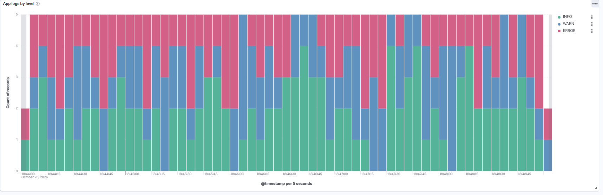
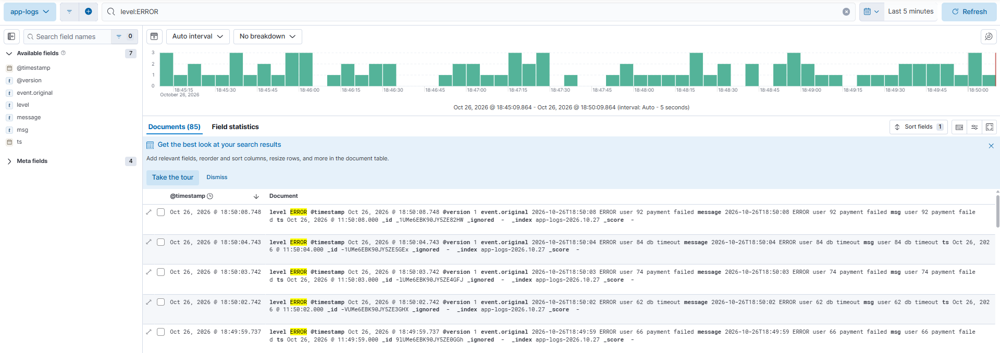

## 1. Data structures

```
python linkedlist.py
```

| Operation | Time | Why |
|---|---|---|
| `push_front` | O(1) | Only changes `head` |
| `push_back` | O(1) | `tail` pointer avoids walking the list |
| `pop_front` | O(1) | Only changes `head` |
| `find` / `delete` | O(n) | Must walk from `head` |
| `reverse` | O(n) time, O(1) space | Re-points each `next` in place |

- **Stack (LIFO):** `push_front` and `pop_front`.
- **Queue (FIFO):** `push_back` and `pop_front`.

## 2. Containerized API on Kubernetes

```
docker build -t hello-api:4 .
minikube start
minikube image load hello-api:4
kubectl apply -f deployment.yaml
kubectl apply -f service.yaml
kubectl get pods
kubectl port-forward service/hello-api-service 8080:80
```

Open http://localhost:8080 and you should see `{"message":"hello world"}`.

Notes:
- The Dockerfile copies `requirements.txt` and installs dependencies **before** copying `app.py`, so code edits reuse the cached install layer and rebuilds take seconds.
- `imagePullPolicy: Never` is used because the image exists only locally, not in a registry. `minikube image load` places it inside minikube's runtime.
- Deleting a pod makes the Deployment's controller start a replacement to restore 3 replicas. The Service keeps a stable address while pod IPs change.

## 3. Kafka

```
docker run -d --name kafka -p 9092:9092 apache/kafka:latest
docker exec kafka /opt/kafka/bin/kafka-topics.sh --create --topic demo2 --partitions 2 --bootstrap-server localhost:9092

# terminal 1 and 2: consumers in two different groups, so each sees every message
python kafka/consumer.py g1
python kafka/consumer.py g2

# terminal 3 and 4: two producers
python kafka/producer.py A
python kafka/producer.py B
```

Findings:
- **Hot partition:** with only two distinct keys, both hashed to the same partition, so one consumer in a group received everything and the other sat idle. Unique per-message keys spread the load across both partitions.
- **Same group vs different groups:** consumers in one group split the partitions between them. Consumers in different groups each receive all messages.
- **Duplicates after killing a consumer:** auto-commit runs every 5 seconds, so a consumer killed before its commit leaves the survivor re-reading from the last committed offset. That is at-least-once delivery. Fixes: idempotent processing (dedupe on a message ID), manual commits after processing, or Kafka transactions.

## 4. Redis and MySQL

```
docker run -d --name redis -p 6379:6379 redis:latest
docker run -d --name mysql -e MYSQL_ROOT_PASSWORD=rootpass -e MYSQL_DATABASE=demo -p 3307:3306 mysql:8

python redis/redis_crud.py
python redis_sql/mysql_crud.py
```

Behavior differences I observed (not speed):

| Situation | Redis | MySQL |
|---|---|---|
| Create the same id twice | Silently overwrites | `IntegrityError` (duplicate primary key) |
| Update an id that doesn't exist | Creates a hash with only that field | Matches 0 rows, changes nothing |
| Read a missing id | `{}` | `None` |
| Schema | None | Table and constraints required |
| Writes | Immediate | Need `commit()` |

A timing comparison script is not included yet (see Notes).

## 5. Logging pipeline (ELK)

```
cd elk
docker compose up -d
python log_app.py
```

- Elasticsearch: http://localhost:9200
- Kibana: http://localhost:5601 (create a data view `app-logs-*` with timestamp field `@timestamp`)

Flow: `log_app.py` sends one line per second over TCP port 5000, Logstash parses it with grok into `ts`, `level` and `msg`, Elasticsearch indexes it into `app-logs-<date>`, and Kibana charts it.




Findings:
- Inside the Compose network, services reach each other by **service name** (`elasticsearch`), not `localhost`.
- The index shows `yellow` health because a replica cannot be placed on the same node as its primary.
- Index names use UTC dates, so an evening log in California lands in tomorrow's index.
- `ts` (the app's local time, no timezone) and `@timestamp` (ingest time, UTC) differ by 7 hours in Kibana. A Logstash `date` filter with an explicit timezone would fix this.
- `level` is mapped as both `text` and `keyword`. The `.keyword` version is used for filtering and aggregation.

Stop with `docker compose down` (keeps data) or `docker compose down -v` (deletes it).
